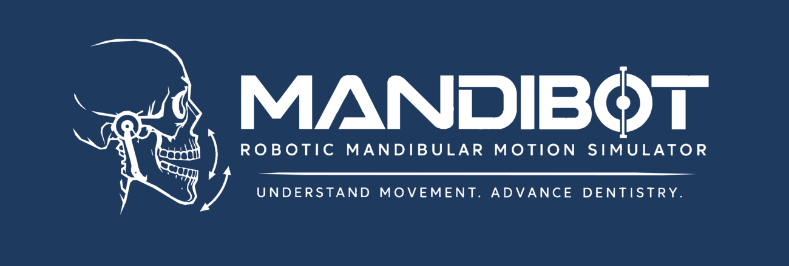
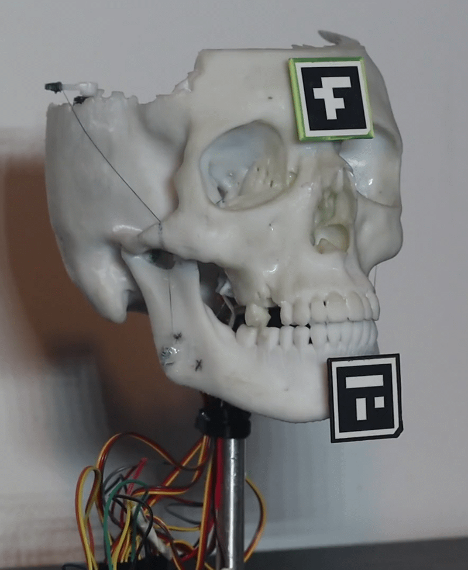
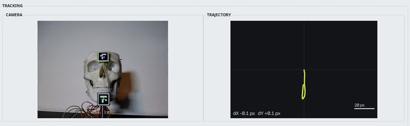
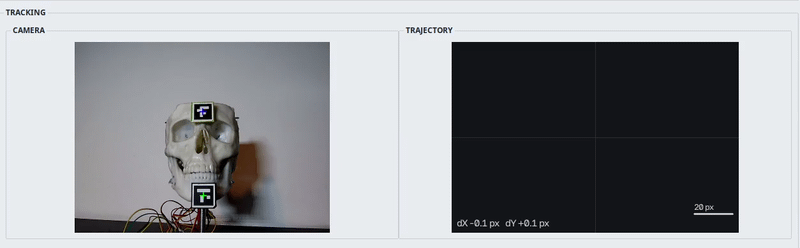
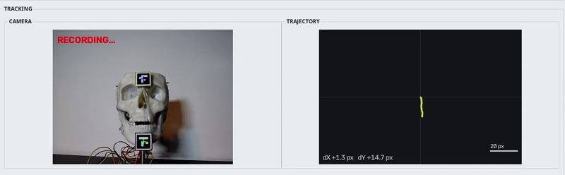
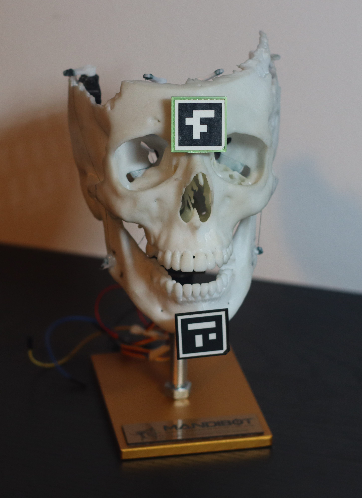
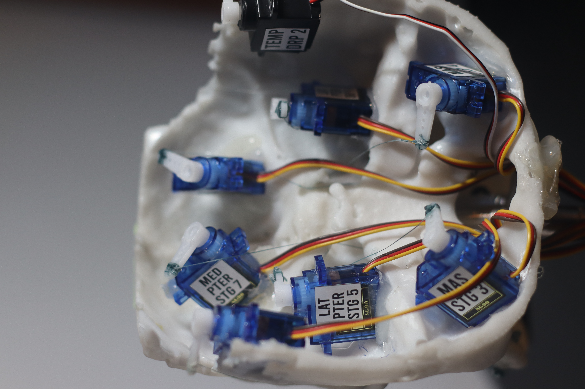
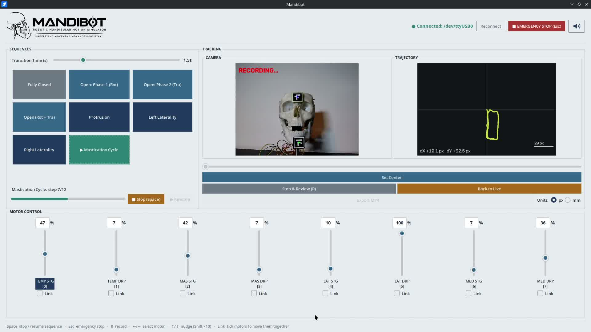
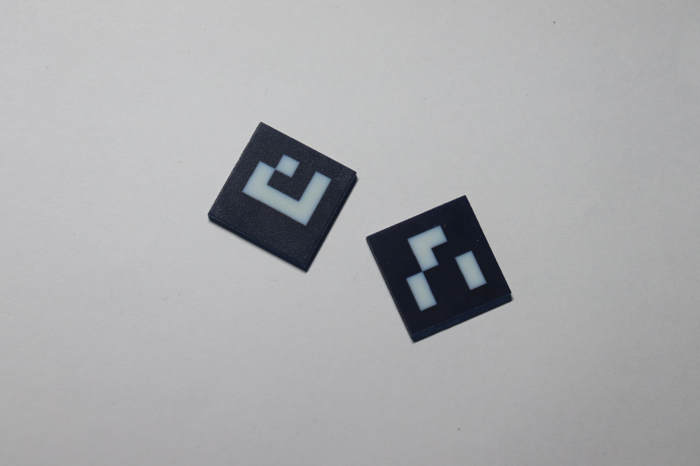

# Mandibot



Mandibot is a mechatronic jaw-motion demonstrator for recreating and observing
mandibular movement. An Arduino Uno drives eight servo channels, while a Python
desktop app provides hands-on control, movement presets, camera tracking, and
recording.

## At a glance

- **Move:** adjust eight servo channels directly or run presets and motion sequences.
- **Observe:** track the jaw relative to a fixed reference with a webcam and ArUco markers.
- **Review:** record the camera view and trajectory together, scrub through a session,
  and export it as an MP4.

## Demonstrations

Motion clips, hardware photos, and the desktop interface screenshot are embedded
directly from `res/`.

### Robot movement



### Laterality



### Opening



### Mastication



### Hardware

The mechanism uses [SG90 micro servos](https://www.towerpro.com.tw/product/sg90-7/)
to drive the jaw through lightweight flexible linkages made with fishing line
and textile/fabric elements. The servos and supporting components are mounted
on a 3D-printed anatomical model based on a real CT scan, with the parts glued
in place to create the assembled demonstrator.

An [Arduino Uno](https://docs.arduino.cc/hardware/uno-rev3/) runs the motion
firmware, and an [Arduino sensor shield](https://wiki.keyestudio.com/KS0005_Keyestudio_Sensor_Shield_V5)
provides a convenient board for connecting the servo signal leads. Each servo
is assigned a dedicated control channel; the firmware maps the desktop
controller's percentage commands to that servo's configured movement range.





### Desktop interface



## How it works

The Python app (`host/controller.py`) is the control panel. It sends changed
motor targets to the Arduino over USB serial at **115200 baud**. The firmware
(`src/main.cpp`) converts each target percentage into that servo's configured
open-to-closed angle and writes it to the servo. On startup, all servos move to
their midpoint (50%).

At the same time, a webcam feed is processed by OpenCV in a background thread.
The tracker looks for two markers from the **`DICT_4X4_50` ArUco dictionary**:

- **ID 15** is the fixed upper reference.
- **ID 13** is attached to the mandible.



The app measures the lower marker's position relative to the upper marker.
**Set Center** resets the reference position; smoothing reduces detection
jitter, and the trajectory panel draws the jaw's movement from that baseline.
The readout can show pixels or an approximate millimetre scale derived from the
printed marker size. Set `MARKER_SIZE_MM` to the actual side length of your
markers; this is an image-based scale estimate, not a full 3D camera
calibration.

Recording captures the camera and trajectory panels together. Stop recording
to review and scrub through the frames, return to the live view, or export the
recording as an MP4.

## Motion controls

The app includes these presets:

- Fully closed
- Opening in two phases: rotation, then translation
- Protrusion
- Left and right laterality
- Mastication cycle: drop, open while shifting left, close onto the left side,
  and return to centric closure; repeats three times

Transitions are animated over the selected duration. Sequences start from the
fully closed position. **Stop** pauses a sequence at its current position and
**Resume** continues it; choosing another preset cancels the sequence.

Use the sliders or enter a value from 0 to 100 for direct positioning. Tick
**Link** under multiple channels to move them together while preserving their
offsets. The keyboard can select and nudge a channel:

| Key | Action |
|---|---|
| Left / Right | Select the previous / next channel |
| Up / Down | Nudge the selected channel by 1 |
| Shift + Up / Down | Nudge by 10 |
| Space | Stop or resume a sequence |
| R | Start or stop recording |
| Esc | Cancel motion and command every channel to 50% |

The Esc button is a **software command**, not a physical power cutoff or
safety-rated emergency stop. Use an appropriate hardware safety mechanism for
your setup.

## Hardware and setup

You will need an Arduino Uno with eight servos connected to the firmware-configured
pins, a computer, a webcam, and two printed ArUco markers with IDs 15 and 13 from
`DICT_4X4_50`. The audio feature is optional and requires a DY-SV8F / DY-SV5W
MP3 module with a track on its SD card.

Install [uv](https://docs.astral.sh/uv/) and PlatformIO, then install the Python
dependencies and upload the firmware:

```bash
make setup
uv tool install platformio
make upload
```

Start the desktop controller:

```bash
make python
```

Or upload the firmware and start the controller in one command:

```bash
make run
```

Connect the Arduino before uploading. The app attempts to connect on startup;
on Linux it auto-detects the first `/dev/ttyUSB*` or `/dev/ttyACM*` port. Use
the **Reconnect** button after reconnecting the board. If no Arduino is
available, the interface opens in UI-only test mode and sends no motor data.

Before use, check the settings near the top of `host/controller.py`:

```python
SERIAL_PORT = None  # auto-detect, or set a port such as "/dev/ttyUSB1"
CAMERA_INDEX = 1
MARKER_SIZE_MM = 20.0
TOP_MARKER_ID = 15
BOTTOM_MARKER_ID = 13
```

Change `CAMERA_INDEX` if your webcam uses a different device index. Print both
markers at the same known size and update `MARKER_SIZE_MM` to match.

## Serial and optional audio

Motor commands are newline-terminated `index:percentage` values. For example,
`3:75` sends channel 3 to 75% of its configured open-to-closed range. The
firmware clamps values to 0–100%.

The optional audio button sends `PLAY` and `STOP` over the same USB connection.
The Arduino forwards those commands to the MP3 module at 9600 baud using
`SoftwareSerial`: pin 4 (Arduino TX) connects to the module RX; pin 7 is used
as the SoftwareSerial RX pin.

For a standalone MP3-module check, `examples/audio-module-test/` contains a
sketch that plays the first track for five seconds and then stops it. It uses
the hardware serial port, so use it separately from the desktop controller.

## Project layout

| Path | Purpose |
|---|---|
| `host/controller.py` | Desktop UI, serial control, camera tracking, recording |
| `host/requirements.txt` | Python dependencies |
| `src/main.cpp` | Arduino servo and audio firmware |
| `examples/audio-module-test/` | Standalone MP3-module test sketch |
| `platformio.ini` | PlatformIO board and library configuration |
| `Makefile` | Setup, upload, and launch shortcuts |
| `res/logo-readme.png` | White-on-navy logo banner used at the top of this README |
| `res/general-gif.gif` | General movement demo |
| `res/left-laterality.gif` | Left laterality demo |
| `res/open.gif` | Opening demo |
| `res/mastication.gif` | Mastication demo |
| `res/robot-front.JPG` | Robot side photo |
| `res/back-motors.JPG` | Internal servo photo |
| `res/interface.jpg` | Desktop interface screenshot |
| `res/aruco.jpg` | ArUco marker reference |

## License

MIT. See [LICENSE](LICENSE).
